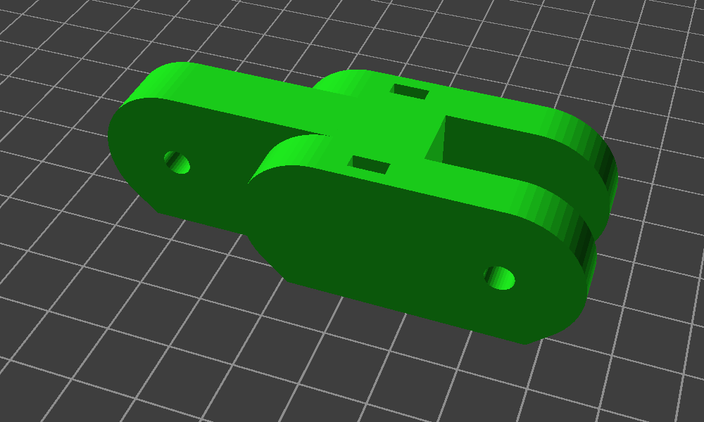
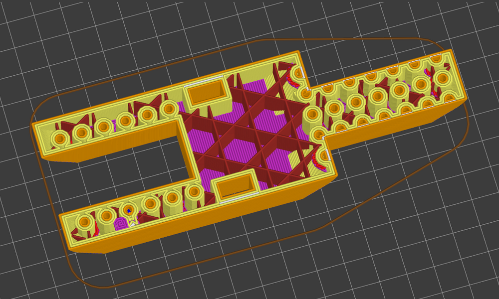

# Strengthening prints with internal holes

A Claude Code skill for making FDM 3D prints much stronger exactly where they need it
(joints, forks, hinge tongues, bolt bosses, clamps) without raising infill or changing your
slicer profile.



## The trick

Your slicer lays perimeters round every hole. Put a grid of small holes *inside* a weak area
and each one gets its own perimeter loops. Packed close together, the loops fuse into solid
posts. That area prints nearly solid, while the rest of the part keeps its normal infill. The
holes never touch the outside, so the part looks and fits exactly the same.

| Without holes | With holes |
|---|---|
|  |  |

One layer of the same arm link, without holes (left) and with them (right). These are
rendered from the model with 4 perimeters and sparse infill, matching what the slicer
showed. Without holes, the fork and tongue are thin walls round sparse infill. With holes,
the joint ends fill with perimeter rings that fuse into solid posts. The middle of the link,
which doesn't need it, keeps its normal infill.

## Where this came from

I found this by accident. I put the wrong screw holes in a part, and it didn't snap where
it should have. That's when it clicked: more holes means more perimeters, and perimeters
are the strongest thing a slicer lays down. I've since seen other people use the same trick.
This skill doesn't invent it. What it adds is having Claude apply it correctly: the right
values, holes that never break the surface, and a check that proves it. You don't have to
place holes by hand or set up modifiers in your slicer.

Slicers don't do this today. The closest tool is a modifier mesh, which raises the infill
inside a box you place by hand. That changes the infill of the whole box, and it's still
infill, which is rarely worth printing at 100%. This trick does something different. It
builds dense, continuous perimeter walls inside the part, exactly round the area that needs
them, and the region comes out close to solid.

Honestly, this should be a slicer feature. A "strengthening" option could find thin areas
around holes and bolt bosses and add these internal walls automatically. Until a slicer does
it, there's this skill.

— symmetryninja

## The recipe

| Rule | Value |
|---|---|
| Hole direction | Vertical in the print orientation (along the printer's Z) |
| Hole diameter | 1 mm (much smaller and the slicer closes it) |
| Spacing | 4 mm centre to centre |
| Side clearance | At least 1 mm from every wall and cavity |
| Top/bottom clearance | 0.5 mm from the top and bottom faces |
| Slicer | At least 4 perimeters, about 0.45 mm lines |

## Using it with other CAD programs

The trick lives in the slicer, so it works whatever you design in. Only the way you add the
holes changes. If Claude is connected to FreeCAD (through its Python or an MCP server), it can
do the whole job in the model for you, then prove the result with the checker.

**1. Post-process the exported STL (any CAD program).** OpenSCAD can import an STL, so the
skill's snippet runs unchanged on a part from Fusion 360 or any other CAD program. Export
the part as STL, already in its print orientation, then:

```openscad
module part_in_print_orientation() import("my_part.stl");
// ...followed by the skill's snippet, unchanged
```

You get the same automatic clipping: holes stay clear of every surface, bolt hole and
pocket. `check_internal_holes.py` then confirms the result against your original STL. This
is the most reliable route. The catch is that it works on a mesh, so you re-run it after
each design change rather than keeping the holes in your CAD model.

**2. Build it in FreeCAD.** The skill includes `strengthen_freecad.py`, which does it
exactly, with the same clearances as the OpenSCAD version. Run it in FreeCAD's Python
console, as a macro, or from a shell on a STEP or STL file. It's tested on FreeCAD 1.1.

The same steps (a hole pattern, a shrunk copy of the part, intersect, cut) could be applied
natively in Fusion 360 and similar parametric CAD, but that hasn't been done or tested yet.
Until then, export an STL or STEP and use route 1, or the FreeCAD script.

**3. Add it in the slicer.** PrusaSlicer, SuperSlicer and OrcaSlicer let you place
negative-volume cylinders inside a part. That works with any file, but you place each one by
hand and nothing keeps them clear of walls and holes. Check the layer preview carefully.

## What the skill gives Claude

- When to use the trick, and the reasons behind each value.
- Paste-ready OpenSCAD that clips the hole grid to a shrunken copy of your part, so holes
  automatically stay clear of every surface, bolt hole and nut pocket.
- `strengthen_freecad.py`, the same method for FreeCAD solids, STEP files or STLs.
- `check_internal_holes.py`, a dependency-free script that proves every hole in an exported
  STL is internal. It compares the outer skin with a hole-free export.
- The common mistakes: horizontal holes, through-holes, holes too small for the slicer,
  too few perimeters, and a grid that misses a thin wall.

## Install

In Claude Code:

```
/plugin install strengthening-prints-with-internal-holes --marketplace symmetryninja/claude-skills
```

See the [top-level README](../README.md#install) for the other ways to install.
