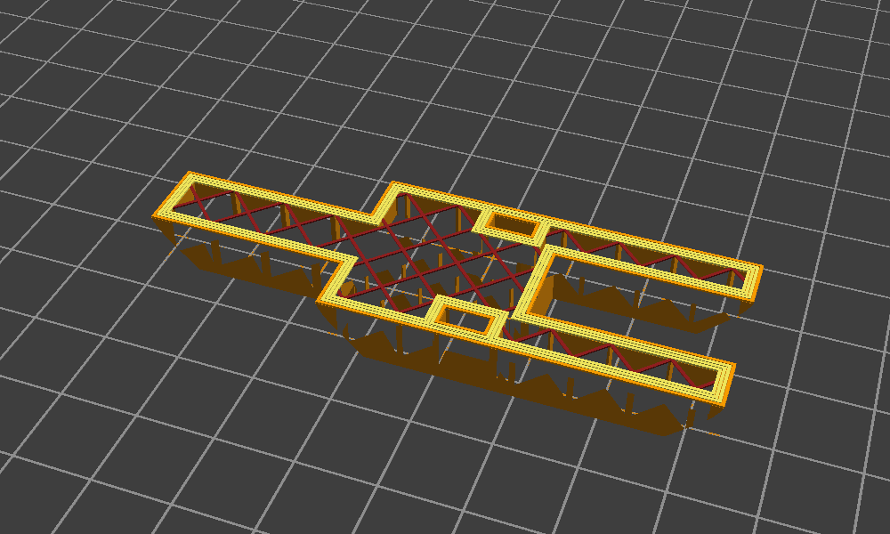

# Strengthening prints with internal holes

A Claude Code skill for making FDM 3D prints much stronger exactly where they need it
(joints, forks, hinge tongues, bolt bosses, clamps) without raising infill or changing your
slicer profile.

## The trick

Your slicer lays perimeters round every hole. Put a grid of small holes *inside* a weak area
and each one gets its own perimeter loops. Packed close together, the loops fuse into solid
posts. That area prints nearly solid, while the rest of the part keeps its normal infill. The
holes never touch the outside, so the part looks and fits exactly the same.

| Without holes | With holes |
|---|---|
|  |  |

## Where this came from

I found this by accident. I put the wrong screw holes in a part, and it didn't snap where
it should have. That's when it clicked: more holes means more perimeters, and perimeters
are the strongest thing a slicer lays down. I've since seen other people use the same trick.
This skill doesn't invent it. What it adds is having Claude apply it correctly: the right
values, holes that never break the surface, and a check that proves it. You don't have to
place holes by hand or set up modifiers in your slicer.

Honestly, this should be a slicer feature. A "strengthening" option could find thin areas
around holes and bolt bosses and add these internal walls automatically. Today you can only
get close by hand, with modifier meshes. Until a slicer does it, there's this skill.

— symmetryninja

## The recipe

| Rule | Value |
|---|---|
| Hole direction | Vertical in the print orientation (along the printer's Z) |
| Hole diameter | 1 mm (much smaller and the slicer closes it) |
| Spacing | 4 mm centre to centre |
| Side clearance | At least 1 mm from every wall and cavity |
| Top/bottom clearance | 0.5 mm from the top and bottom faces |
| Slicer | At least 4 perimeters, about 0.45 mm lines |

## What the skill gives Claude

- When to use the trick, and the reasons behind each value.
- Paste-ready OpenSCAD that clips the hole grid to a shrunken copy of your part, so holes
  automatically stay clear of every surface, bolt hole and nut pocket.
- `check_internal_holes.py`, a dependency-free script that proves every hole in an exported
  STL is internal. It compares the outer skin with a hole-free export.
- The common mistakes: horizontal holes, through-holes, holes too small for the slicer,
  too few perimeters, and a grid that misses a thin wall.

## Install

In Claude Code:

```
/plugin install strengthening-prints-with-internal-holes --marketplace symmetryninja/claude-skills
```

See the [top-level README](../README.md#install) for the other ways to install.
